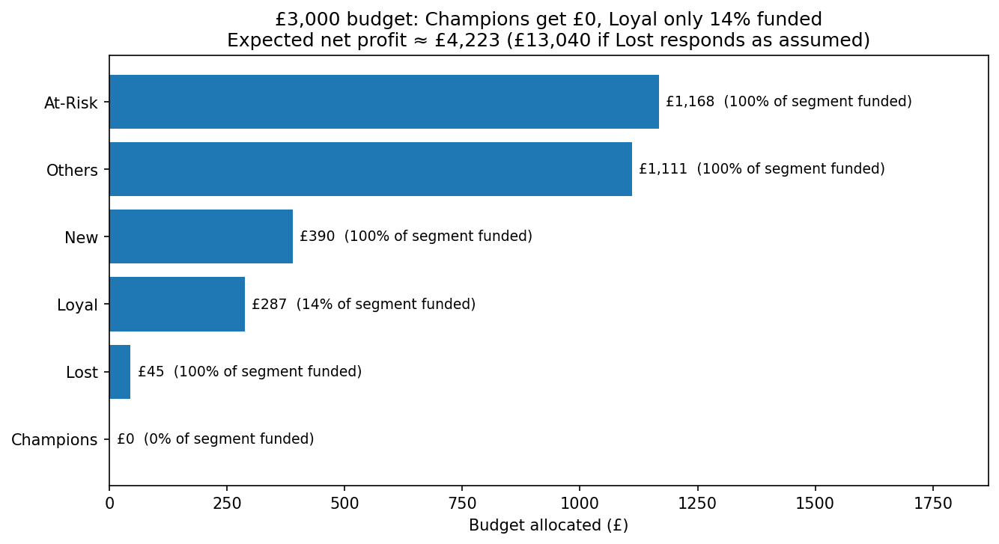
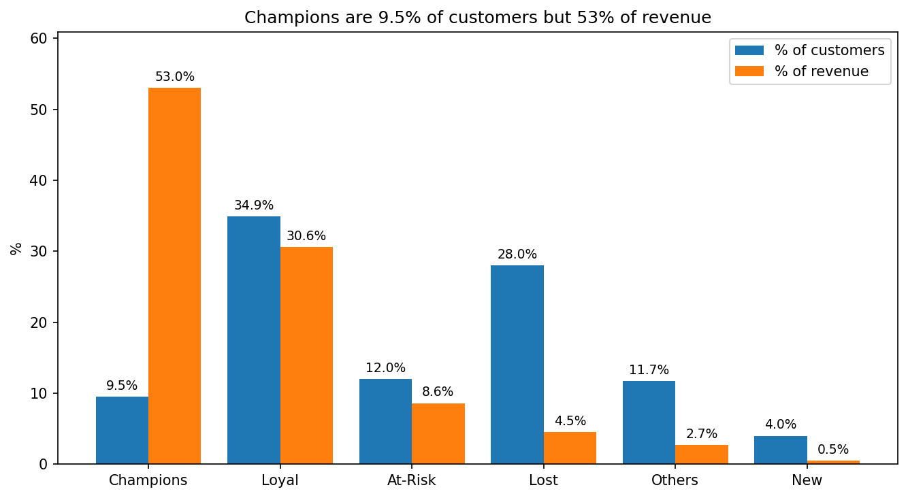
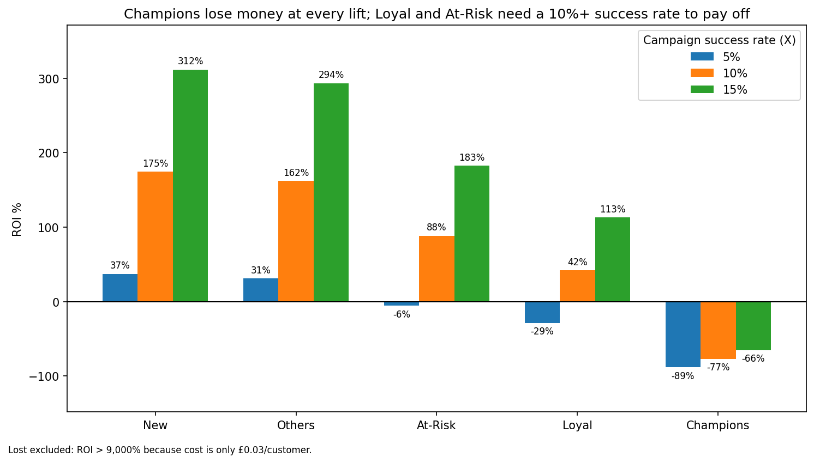

# Customer Segmentation & RFM Analysis

> **Business question:** Which customer segments give the highest ROI on retention campaigns, and how should the marketing team allocate budget?

**Tools:** Python (pandas, NumPy, Matplotlib) · Jupyter Notebook                             
**Data:** [UCI Online Retail II] (UK online gift retailer, Dec 2009 – Dec 2011)                 

---

## TL;DR

I segmented 5,322 UK customers with RFM scoring and built an ROI model to split a **£3,000 retention budget**.

- **Champions** are 9.5% of customers but **53% of revenue**, yet they should get **£0** of this budget. 97% of them came back in a backtest even without a campaign, so there is almost nothing a retention campaign can add.
- **At-Risk, Others and New** are funded in full. **Loyal** gets the remaining £287, spent on its 266 highest-value targets.
- Expected net profit is **~£4,200**, or up to **~£13,000** if the Lost segment responds as assumed. About two-thirds of that upside rests on a single assumption, so I report both numbers.



---

## Key idea: headroom

A retention campaign can only win back customers who would **not** have returned anyway.

> **Headroom = 1 − (share of customers who return without any campaign)**

Champions are the most valuable segment, but their headroom is only ~3%. Ranking segments by value alone would waste the budget. I estimated headroom with a backtest and used it to drive the ROI model.

---

## Approach

| Step | What I did |
|---|---|
| 1. Clean | Removed missing Customer IDs, duplicates, non-product stock codes, matched cancellations and zero-price rows |
| 2. RFM | Calculated Recency, Frequency and Monetary value per customer, then scored each 1 to 5 |
| 3. Segment | Rule-based segments: Champions, Loyal, At-Risk, Lost, plus New and Others |
| 4. ROI model | Estimated profit per customer and campaign cost per segment |
| 5. Backtest | Used the data from before 9 Dec 2010 to check who actually came back afterwards |
| 6. Allocate | Funded segments in order of ROI until the £3,000 budget ran out, skipping negative-ROI segments |

### Data cleaning decisions

| Decision | Why |
|---|---|
| UK customers only (981,330 of 1,067,371 rows) | 92% of the data. Other countries are too small to segment separately |
| Dropped rows with no Customer ID | Purchases cannot be linked to one person, so RFM cannot be computed |
| Removed non-product codes (postage, bank charges, adjustments, tests) | They are not sales |
| Matched cancellations to their original purchase and removed both | A cancelled order is not a purchase |
| Removed cancellations with no matching purchase | Their original order is outside the dataset |
| Snapshot date = last transaction date + 1 day | Recency must be measured from the end of the data, not from today |

Final dataset: **702,393 rows, 5,322 customers.**

### RFM scoring

- **Recency and Monetary:** quintiles (`pd.qcut`). Both are skewed, so equal-width bins would put almost everyone in one bucket.
- **Frequency:** custom bins (1 | 2 | 3–5 | 6–12 | 13+). Many customers share the same low counts, so quintiles would split customers who behave identically.

### Segments

| Segment | Rule |
|---|---|
| Champions | R ≥ 4 and F = 5 |
| Loyal | R ≥ 3 and F ≥ 3 |
| At-Risk | R ≤ 2 and F ≥ 3 |
| Lost | R ≤ 2 and F ≤ 2 |
| New | R ≥ 4 and F = 1 |
| Others | everyone else |



---

## ROI model

For each segment:

```
lift             = headroom × X
expected profit  = average order value × lift × margin
ROI              = (expected profit − cost) / cost
```

**Assumptions**

| Assumption | Value |
|---|---|
| Gross margin | 30% |
| Campaign success rate **X** (share of at-risk-of-leaving customers won back) | 10% base case, tested at 5% and 15% |
| Channel cost per customer | email £0.03 · SMS £0.05 · ads £0.75 · direct mail £1.00 |
| Incentive per customer | £1 (£0 for Lost) |

Channel mix differs by segment (e.g. Lost gets email only; Champions get email, SMS and mail).

---

## Results (base case, X = 10%, £3,000 budget)

| Segment | Customers | Budget | Share of segment funded | ROI |
|---|---|---|---|---|
| At-Risk | 638 | £1,168 | 100% | 88% |
| Others | 624 | £1,111 | 100% | 162% |
| New | 213 | £390 | 100% | 175% |
| Loyal | 1,855 | £287 | 14% (best 266 customers) | ~245% for the selected customers |
| Lost | 1,488 | £45 | 100% | very high (cost is £0.03 per customer) |
| Champions | 504 | £0 | 0% | −77% |

### Is the recommendation robust?



- **Champions lose money at every success rate tested.**
- **At-Risk and Loyal** are the most sensitive. Both lose money at 5% and pay off from about 10%.
- **New and Others** stay positive even at 5%.
- **Lost** is excluded from this chart because its ROI exceeds 9,000% (it costs only £0.03 per customer). It looks the best on paper, but the profit is small in absolute terms and depends on one assumption.

### Recommendation

1. Fund At-Risk, Others and New in full.
2. Spend the remainder on the most valuable Loyal customers.
3. Spend nothing on Champions in this campaign. They need a different lever (spend per order, for example VIP perks), not retention.
4. Before scaling, **run an A/B test with a holdout group** to measure the real success rate.

---

## Limitations

- **X = 10% is an assumption.** The dataset contains no campaign, so it cannot be measured here.
- **Lost drives most of the headline profit** and rests on a £0.03 email producing a ~6% lift. In the backtest 37% of "Lost" customers came back on their own, so the label is imperfect.
- **Allocation is done at segment level.** Ranking individual customers by expected profit would probably shift the budget. For example, the selected Loyal customers return ~245% ROI, higher than the At-Risk segment (88%).
- **Headroom comes from one backtest window** (snapshot 9 Dec 2010) and is estimated by recency score, not per customer.
- **UK only, and customers without an ID are excluded** (about 24% of UK rows), so the results do not describe them.

---

## What I would do next

- Run a real A/B test and replace the assumed success rate with a measured one.
- Rank individual customers by expected profit instead of allocating by segment.
- Repeat the RFM step in SQL.

---

## Repository structure

```
├── Customer_Segmentation_and_RFM_Analysis.ipynb
├── images/
│   ├── chart1_revenue.png
│   ├── chart2_sensitivity.png
│   └── chart3_allocation.png
└── README.md
```

## How to run

1. Download `online_retail_II.csv` from the [UCI repository](https://archive.ics.uci.edu/dataset/502/online+retail+ii) and place it in the same folder as the notebook. (The file is ~94 MB, so it is not included here.)
2. Install the requirements: `pip install pandas numpy matplotlib jupyter`
3. Open the notebook and choose **Kernel → Restart & Run All**.

---

## About me

**[Your Name]** · [LinkedIn](https://www.linkedin.com/in/your-profile) · [Email](mailto:your.email@example.com)
